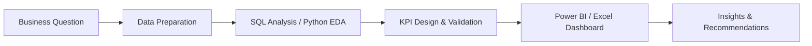

```markdown
<!-- =========================================================
     GITHUB PROFILE README | Abdel-Alim
     Save this file as README.md inside github.com/Abdel-Alim/Abdel-Alim
     ========================================================= -->

<p align="center">
  
</p>

<p align="center">
  
</p>

<p align="center">
  <a href="https://github.com/Abdel-Alim">
    
  </a>
  <a href="https://github.com/Abdel-Alim?tab=repositories">
    
  </a>
</p>

<p align="center">
  <a href="#about-me">About</a> &nbsp;·&nbsp;
  <a href="#featured-projects">Featured Projects</a> &nbsp;·&nbsp;
  <a href="#technical-toolkit">Technical Toolkit</a> &nbsp;·&nbsp;
  <a href="#my-approach">My Approach</a> &nbsp;·&nbsp;
  <a href="#github-activity">GitHub Activity</a>
</p>

---

## About Me

I'm a **Data Analyst / BI Analyst** focused on turning raw data into clear, decision-ready insights. I use **SQL Server, Power BI, Excel, and Python** to prepare data, explore business questions, build interactive dashboards, and communicate findings in a practical way.

My portfolio also includes **Natural Language Processing (NLP) and Machine Learning** projects, giving me experience across both business intelligence and applied analytics.

- **Primary focus:** Data Analytics and Business Intelligence
- **Business tools:** SQL Server, Power BI, Excel, Power Query, and DAX
- **Additional technical interests:** Python, NLP, and Machine Learning
- **What matters to me:** Clean analysis, understandable visuals, reproducible workflows, and recommendations connected to business questions

> I aim to make data useful: clarify the question, validate the numbers, communicate the insight, and help identify the next action.

---

## Featured Projects

The projects below are selected to show how I approach different analytical problems, from business dashboards to machine learning.

<table>
  <tr>
    <td width="50%" valign="top">
      <a href="https://github.com/Abdel-Alim/E-Commerce-Customer-Churn-Analysis">
        
      </a>
      <h3><a href="https://github.com/Abdel-Alim/E-Commerce-Customer-Churn-Analysis">01 · E-Commerce Customer Churn</a></h3>
      <p><b>SQL Server · Power BI</b></p>
      <p>Customer churn analysis covering churn patterns, complaint impact, product categories, marital status, satisfaction, and retention opportunities. Includes SQL data preparation and an executive dashboard.</p>
      <p><a href="https://github.com/Abdel-Alim/E-Commerce-Customer-Churn-Analysis">Explore repository →</a></p>
    </td>
    <td width="50%" valign="top">
      <a href="https://github.com/Abdel-Alim/Coffee-Shop-Sales-Business-Intelligence-power-bi-Dashboard">
        
      </a>
      <h3><a href="https://github.com/Abdel-Alim/Coffee-Shop-Sales-Business-Intelligence-power-bi-Dashboard">02 · Coffee Shop Sales BI</a></h3>
      <p><b>Power BI · DAX · Power Query</b></p>
      <p>Interactive analysis of revenue, orders, products, store locations, and time-based sales patterns, with KPI reporting and transaction-level exploration.</p>
      <p><a href="https://github.com/Abdel-Alim/Coffee-Shop-Sales-Business-Intelligence-power-bi-Dashboard">Explore repository →</a></p>
    </td>
  </tr>
  <tr>
    <td width="50%" valign="top">
      <a href="https://github.com/Abdel-Alim/Cosmetics-Sales-BI-Dashboard">
        
      </a>
      <h3><a href="https://github.com/Abdel-Alim/Cosmetics-Sales-BI-Dashboard">03 · Cosmetics Sales BI</a></h3>
      <p><b>Power BI · DAX · Power Query</b></p>
      <p>Executive-focused dashboard for sales, profit, orders, customers, products, markets, regions, and time-based performance.</p>
      <p><a href="https://github.com/Abdel-Alim/Cosmetics-Sales-BI-Dashboard">Explore repository →</a></p>
    </td>
    <td width="50%" valign="top">
      <a href="https://github.com/Abdel-Alim/Sales-Performance-Dashboard-Excel">
        
      </a>
      <h3><a href="https://github.com/Abdel-Alim/Sales-Performance-Dashboard-Excel">04 · Sales Performance Dashboard</a></h3>
      <p><b>Excel · PivotTables · PivotCharts · Slicers</b></p>
      <p>Interactive sales and profitability analysis by category, sub-category, customer segment, region, and year, using connected filters and KPI cards.</p>
      <p><a href="https://github.com/Abdel-Alim/Sales-Performance-Dashboard-Excel">Explore repository →</a></p>
    </td>
  </tr>
</table>

### More Projects

| Project | Tools | What it demonstrates |
|---|---|---|
| [Coca-Cola Sales & Retailer Dashboard](https://github.com/Abdel-Alim/Cocacola-excel-dashboard-) | Excel, PivotTables, PivotCharts, Slicers | Sales, operating profit, brands, retailers, regions, and monthly trends |
| [Bike Purchase & Customer Analysis](https://github.com/Abdel-Alim/Excel-Data-Analysis-Dashboard) | Excel, PivotTables, PivotCharts, Slicers | Customer segmentation by income, age, region, commute, and purchase behavior |
| [Student Performance Dashboard](https://github.com/Abdel-Alim/Student_Performance_Dashboard-_Excel) | Excel, PivotTables, PivotCharts, Slicers | Academic KPIs, pass/fail rates, school and subject comparisons, and exam analysis |
| [Emotion Classification with NLP](https://github.com/Abdel-Alim/Emotion-classification_nlp) | Python, NLTK, TF-IDF, Naive Bayes, Linear SVM | Text preprocessing, six-class emotion prediction, model comparison, evaluation, and error analysis |

---

## Technical Toolkit

### Data Analytics & Business Intelligence

<p>
  
  
  
  
  
</p>

### Python, NLP & Machine Learning

<p>
  
  
  
  
  
  
  
</p>

### Tools & Workflow

<p>
  
  
  
</p>

**Analytical skills:** Data Cleaning · Exploratory Data Analysis (EDA) · KPI Design · Customer Segmentation · Churn Analysis · Data Visualization · Dashboard Storytelling · Model Evaluation

---

## My Approach

I follow a repeatable workflow that connects the business question to a useful outcome.



| Stage | Focus |
|---|---|
| Understand | Define the question, users, and measures of success |
| Prepare | Clean data, handle missing values, and standardize categories |
| Analyze | Use SQL or Python to find patterns and compare segments |
| Validate | Check calculations and make KPI definitions clear |
| Communicate | Present findings through clear visualizations and concise explanations |
| Recommend | Connect findings to practical next steps for the business |

---

## GitHub Activity

<p align="center">
  
  
</p>

<p align="center">
  
</p>

---

## Current Professional Focus

I'm strengthening my portfolio around **Data Analyst and BI Analyst** work: SQL-based analysis, well-designed Power BI dashboards, reliable KPIs, and business recommendations. My NLP and Machine Learning projects complement this focus by demonstrating additional Python-based analytical skills.

**Interested in:** Data Analytics · Business Intelligence · SQL · Power BI · Excel · Applied Analytics

---

## Let's Connect

The best place to explore my work is here on GitHub. Feel free to browse the repositories, review the project documentation, and share feedback or collaboration ideas.

<p align="center">
  <a href="https://github.com/Abdel-Alim">
    
  </a>
</p>

<p align="center">
  
</p>
```
