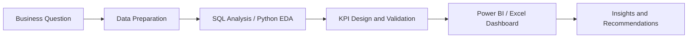

# Abdel-Alim Wagih | Data Analyst & BI Analyst

### Turning Data into Decisions Through Analytics, Business Intelligence, and Applied AI.

[About Me](#-about-me) · [Featured Projects](#-featured-projects) · [Technical Toolkit](#-technical-toolkit) · [Workflow](#-how-i-work) · [GitHub Activity](#-github-activity)

---

## 👋 About Me

I'm a **Data Analyst / BI Analyst** focused on transforming raw data into clear, validated, and actionable business insights.

I use **SQL Server, Power BI, Excel, and Python** to investigate business questions, develop meaningful KPIs, analyze performance, and communicate findings through interactive dashboards and structured reports.

My portfolio also includes **Natural Language Processing (NLP) and Machine Learning** projects, demonstrating additional experience in text processing, classification, model evaluation, and Python-based analytical workflows.

- 📊 **Primary Focus:** Data Analytics and Business Intelligence
- 🧮 **Analytics Stack:** SQL Server, Power BI, DAX, Power Query, and Excel
- 🐍 **Additional Skills:** Python, Pandas, NumPy, scikit-learn, NLP, and Machine Learning
- 🎯 **Professional Values:** Accurate metrics, clear visualizations, reproducible analysis, and business-focused recommendations

> My approach is simple: understand the business question, prepare and validate the data, communicate the insight, and identify practical next steps.

---

## 🚀 Featured Projects

<table>
<tr>
<td width="50%" valign="top">

### 📉 E-Commerce Customer Churn Analysis

**SQL Server · Power BI**

A customer-retention analysis project exploring churn patterns, complaint impact, customer behavior, product categories, satisfaction, and potential retention opportunities.

**Key Highlights**
- SQL-based data preparation and analysis
- Customer churn investigation
- Executive dashboard and business-focused findings

[**Explore Repository →**](https://github.com/Abdel-Alim/E-Commerce-Customer-Churn-Analysis)

</td>
<td width="50%" valign="top">

### ☕ Coffee Shop Sales BI Dashboard

**Power BI · DAX · Power Query**

An interactive dashboard designed to analyze revenue, orders, products, store performance, and sales trends over time.

**Key Highlights**
- KPI-driven overview
- Product, store, and time analysis
- Transaction-level exploration

[**Explore Repository →**](https://github.com/Abdel-Alim/Coffee-Shop-Sales-Business-Intelligence-power-bi-Dashboard)

</td>
</tr>
<tr>
<td width="50%" valign="top">

### 💄 Cosmetics Sales BI Dashboard

**Power BI · DAX · Power Query**

An executive-focused dashboard for analyzing sales, profitability, orders, customers, products, markets, regions, and customer segments.

**Key Highlights**
- Executive KPI summary
- Sales and profit trends
- Product and market comparisons

[**Explore Repository →**](https://github.com/Abdel-Alim/Cosmetics-Sales-BI-Dashboard)

</td>
<td width="50%" valign="top">

### 📊 Sales Performance Dashboard

**Excel · PivotTables · PivotCharts · Slicers**

An interactive Excel dashboard for analyzing sales performance and profitability across business dimensions.

**Key Highlights**
- KPI reporting
- Interactive filters
- Category, sub-category, segment, and regional analysis

[**Explore Repository →**](https://github.com/Abdel-Alim/Sales-Performance-Dashboard-Excel)

</td>
</tr>
</table>

---

## 📊 More Analytics Projects

| Project | Tools | Analytical Focus |
|---|---|---|
| [Coca-Cola Sales & Retailer Dashboard](https://github.com/Abdel-Alim/Cocacola-excel-dashboard-) | Excel | Sales, operating profit, retailers, brands, regions, and monthly trends |
| [Bike Purchase & Customer Analysis](https://github.com/Abdel-Alim/Excel-Data-Analysis-Dashboard) | Excel | Customer segmentation and purchase behavior |
| [Student Performance Dashboard](https://github.com/Abdel-Alim/Student_Performance_Dashboard-_Excel) | Excel | Academic KPIs and student-performance comparisons |

---

## 🤖 NLP & Machine Learning

My NLP and Machine Learning projects complement my analytics portfolio with practical work in text preprocessing, classification, and model evaluation.

| Project | Tools / Focus |
|---|---|
| [Emotion Classification](https://github.com/Abdel-Alim/Emotion-classification_nlp) | Python, text preprocessing, TF-IDF, and multi-class emotion prediction |

**Explore more:** [Browse All Public Repositories →](https://github.com/Abdel-Alim?tab=repositories)

---

## 🧰 Technical Toolkit

### Data Analytics & Business Intelligence

### Python, NLP & Machine Learning

### Tools & Workflow

**Analytical Skills:** Data Cleaning · Exploratory Data Analysis (EDA) · KPI Definition · Customer Segmentation · Churn Analysis · Trend Analysis · Data Visualization · Dashboard Storytelling · Classification · Model Evaluation

---

## 🔍 How I Work

| Stage | Description |
|---|---|
| **Understand** | Define the business question and success criteria |
| **Prepare** | Clean data, handle missing values, and standardize categories |
| **Analyze** | Investigate trends, compare performance, and identify patterns |
| **Validate** | Verify calculations, assumptions, and KPI definitions |
| **Communicate** | Present findings through clear visuals and concise explanations |
| **Recommend** | Connect insights to practical business actions |

---

## 📈 GitHub Activity

*GitHub statistics and activity charts are generated by external services. If a service is temporarily unavailable, the rest of this profile and its project links remain accessible.*

---

## 🎯 Current Professional Focus

I'm strengthening my portfolio for **Data Analyst and BI Analyst opportunities**, focusing on SQL-based analysis, well-designed Power BI dashboards, reliable KPIs, and actionable business recommendations.

My NLP and Machine Learning projects complement this focus by demonstrating additional Python-based analytical skills.

**Interested In:** Data Analytics · Business Intelligence · SQL · Power BI · Excel · Applied Analytics

---

## 🤝 Let's Connect

Thanks for visiting my profile!

Explore my repositories to review my projects, dashboards, analytical workflows, and technical documentation.

